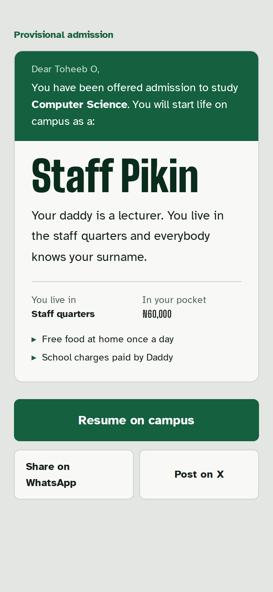
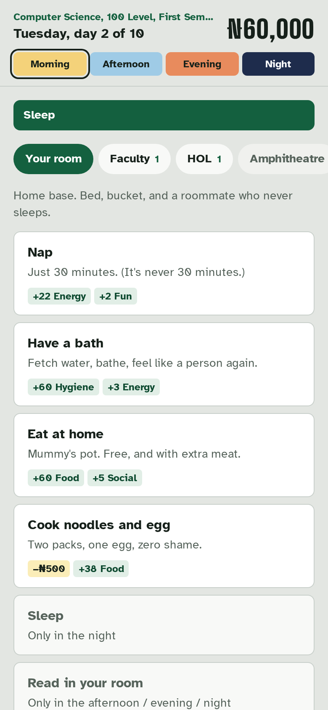
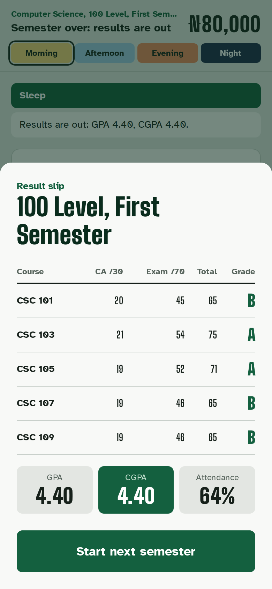

# Great Ife Life

**Four years. One CGPA. Survive Great Ife.**

A browser life-simulation game about student life at Obafemi Awolowo University. Get admitted, attend lectures, read at HOL, hustle for money, survive NEPA, water scarcity and the occasional ASUU strike, write your tests and exams, and graduate. Or don't.

Inspired by the viral Nigerian life simulator *Lagos Life*, but built around the one thing every Nigerian student understands: **your CGPA**.

**Play it:** _add your Render URL here_

> Unofficial fan game. Not made or endorsed by Obafemi Awolowo University.

| Admission | Playing | Result slip | Graduation |
|---|---|---|---|
|  |  |  |  |

## How it plays

- **Admission is fate.** You pick your course, and the game picks your life:
  - **Staff Pikin:** big allowance, free food at home.
  - **Scholarship Kid:** studies faster, but the stipend stops below a 3.50 CGPA.
  - **Hustler Fresher:** no allowance, hard mode.
  - **Off-Campus Student:** freedom, but transport costs money.
- **Every day has four slots:** morning, afternoon, evening and night. Each action takes one: attend a lecture, read at HOL, eat amala at the buka, braid hair for money, play football, gist with roommates or sleep.
- **Keep five needs up:** food, energy, hygiene, fun and social. Neglect them and you collapse, or burn out and your reading stops working.
- **Readiness** goes up as you study. The **CA test** (30%) and **exams** (70%) turn it into grades on the 5-point scale, A to F. Failed courses become **carryovers**.
- **Pay your school charges** or you can't write exams. Short on money? A loan app will lend it to you, and take back 30% more.
- **Random campus events:**
  - NEPA takes light, and the taps run dry.
  - Your roommate borrows money.
  - The lecturer doesn't show up.
  - Free jollof at a departmental seminar.
  - SU elections.
  - The rare ASUU strike that pauses everything.
- **Skills with five levels (like careers in Lagos Life):** graphic design, coding, hairdressing, content creation and teaching. Practice and gigs earn XP. Higher levels pay more and unlock big jobs: a website for ₦22,000, wedding hair, brand deals. Skits can go viral.
- **Businesses that pay out every night:** a data kiosk, a printing stand (busiest before exams) and a food stall. Some days are bad days (the network goes down, the printer jams, NEPA spoils your stock). Selling one gets you 60% back.
- **15 badges** to chase: First A, Straight As, Night crawler, Hustle king, Tycoon, Survived ASUU, Loan app victim…
- **Graduate after 8 semesters** (plus an extra year if you have carryovers) with a degree class, a shareable graduation card, and a place on the leaderboard.

A full degree takes about 330 moves. Every move is saved on the server. **Create a free account** (username and password, no email) to continue on any phone, and see all your past lives, like signing in to Lagos Life. Without an account, a save code works too.

## Engineering highlights

- **The server decides everything.** The browser only says "I want to do X". The server checks it's allowed, applies the rules inside a database transaction, and sends back the new state. Players can't edit their money or grades in the browser, which is how Lagos Life's economy was broken by hacked billions.
- **No double moves.** Every move carries the turn number it was made on. A double tap or a replayed request gets `409 Conflict` instead of acting twice, and rows are locked with `select_for_update`.
- **Luck can't be rerolled.** Randomness is seeded from the game's seed plus the turn number, so retrying a request gives the same outcome.
- **A pure rules engine.** `game/engine.py` has no Django or database code. It takes a state and returns a new one, which makes it easy to test, and easy to simulate thousands of games to balance.
- **Balanced by simulation.** Bots with different play styles played full degrees from every starting life, and the results shaped the rules. Hard work earns a 2:1 (a First if you're excellent), balanced play a 2:2, and neglect fails. Carryovers can't snowball, the strike hits about 1 in 3 degrees, and the Hustler is hard mode but winnable.
- **Built for Nigerian networks.**
  - Rate limits apply per game, not per IP, because campus Wi-Fi and mobile carriers put thousands of students behind one IP.
  - Fonts are self-hosted.
  - The whole JavaScript bundle is about 60 kB gzipped.
- **Shareable by design.** The admission letter and graduation card are made to be shared on WhatsApp and X. Shared card links get personalised preview text ("Tunde graduated with First Class (4.62)") generated by the server.
- **Accounts that work for students.** Username and password only, with no email or phone number collected. Each device gets its own token (stored hashed), so signing in on a laptop doesn't log your phone out. Password guessing is rate-limited per username.
- **An installable app (PWA).** It has a web app manifest, maskable icons and a service worker, so it installs to the home screen, opens full screen, and loads even offline. Game moves are never cached, so progress can't fork or be faked offline.
- **Old saves keep working.** `engine.upgrade()` brings saved games up to the newest version when you open them, so updates never wipe anyone's progress.
- **Safe for a student audience.** Many students are under 18, so there's no chat, dating, or money transfers between players. Leaderboard names are filtered, and admins can hide a game in Django admin.

## Tech

| | |
|---|---|
| Backend | Django 5.2, Django REST Framework |
| Frontend | React 18, React Router, Vite, Tailwind CSS v4 |
| Fonts | Big Shoulders Display, Atkinson Hyperlegible (self-hosted) |
| Database | PostgreSQL (Neon) in production, SQLite locally |
| Hosting | One free Render web service; Django serves the built React app with WhiteNoise |
| Tests | 47 backend tests (pytest), frontend unit tests (Vitest), browser walkthroughs incl. two-device sign-in and offline (Playwright) |

```
backend/
  game/content.py   places, actions, profiles, departments, events: edit this to add jokes
  game/engine.py    the rules: time, needs, money, tests, exams, grades, events, graduation
  game/views.py     API: new game, move, choose, continue, leaderboard, share cards
  config/views.py   serves the React app, with share previews for /c/<code>
  tests/
frontend/src/
  pages/            Title, NewGame, Admission, Play, Graduation, CardPage, Leaderboard
  components/       Status (needs, time of day), Dialogs (events, result slip), GradCard
```

### Adding content

Most of the fun lives in [`backend/game/content.py`](backend/game/content.py). To add a place, an action or an event, add a dictionary there. For example:

```python
{"id": "mozambique_buka", "place": "buka", "label": "Fried rice at the hall buka", "slots": [1, 2],
 "cost": 1200, "effects": {"hunger": 50, "fun": 5}, "blurb": "Extra plantain if you know the seller.",
 "campus": True},
```

After a change, run `pytest`: the fuzz test plays full degrees with random moves and checks that nothing breaks.

## Run it locally

You need Python 3.11+ and Node 20+.

```bash
# Backend
cd backend
python -m venv .venv
source .venv/bin/activate          # Windows (Git Bash): source .venv/Scripts/activate
pip install -r requirements.txt
python manage.py migrate
python manage.py runserver

# Frontend (second terminal)
cd frontend
npm install
npm run dev                        # http://localhost:5173
```

```bash
cd backend && pytest               # 47 tests, including whole simulated degrees
cd frontend && npm test
```

## Deploy on Render (free)

1. Create a free Postgres database on [Neon](https://neon.tech) and copy its connection string (click *Show password* first).
2. On Render, go to **New → Blueprint** and pick this repository. Render reads `render.yaml`. Paste the Neon string into `DATABASE_URL`.
3. Wait for the first deploy (about 5 minutes), then open the URL and get admitted.

Optional environment variables: `THROTTLE_ACT` (default `240/min` per game), `THROTTLE_NEW_GAME` (default `300/hour` per IP), `THROTTLE_LOGIN` (default `10/min` per username).

## Get it on phones

### 1. Install from the website (works today, free)

Once deployed, the game is an installable app:
- **Android:** open the site in Chrome, tap **Install the app on your phone** on the title screen (or Chrome's menu, then **Install app**).
- **iPhone:** open the site in Safari, tap **Share**, then **Add to Home Screen**.

It gets its own icon and opens full screen. This is how most players should install it at first: it's free, and updates reach everyone instantly.

### 2. Publish on Google Play

Because the game is a proper PWA, it can be wrapped as a **Trusted Web Activity**: a real Android app that shows your site full screen. You don't need to rewrite anything.

1. **Create a Google Play developer account** at [play.google.com/console](https://play.google.com/console). There's a one-time fee (about $25), and Google verifies your identity.
2. **Package the app with PWABuilder.** Go to [pwabuilder.com](https://www.pwabuilder.com), enter your Render URL, and choose **Package for stores → Android**. Use a package ID like `com.horrly.greatifelife`. You get:
   - an `.aab` file (the app),
   - a signing key, which you must **back it up and never lose**,
   - an `assetlinks.json` with your certificate's SHA-256 fingerprint.
3. **Prove you own the site.** In Render's Environment tab, set:
   - `ANDROID_PACKAGE_NAME`: your package ID.
   - `ANDROID_CERT_SHA256`: the fingerprint. After the first upload, also add the **App signing key certificate** fingerprint from Play Console → *Test and release → App integrity*, comma-separated.

   Then check `https://<your-app>/.well-known/assetlinks.json` shows them. Without this, the app shows a browser address bar.
4. **Closed testing first.** New personal developer accounts must run a closed test with **at least 12 testers for 14 days in a row** before they can publish to everyone. OAU friends and coursemates are perfect testers.
5. **Store listing:** screenshots (in `docs/screenshots/`), the 512px icon (`frontend/public/icons/icon-512.png`), a short description, the content rating questionnaire, and a privacy policy link: use `https://<your-app>/privacy` (already built into the game).
6. **Apply for production access** in Play Console, then publish.

Updates to the website reach the Android app automatically. You only re-upload to Play to change the icon, name or package.

### 3. The App Store (later)

The iPhone App Store is harder for a web game:
- The Apple Developer Program costs **$99 a year**.
- You need a **Mac with Xcode**, or a cloud build service.
- Apple's guideline **4.2 (Minimum Functionality)** rejects apps that are "just a website in a shell".

The realistic route is to wrap the same React app with **Capacitor** and add native features Apple values, like push notifications ("Exams start tomorrow!") and the native share sheet. Until then, iPhone players can install it from Safari (step 1), which works well.

## Ideas for what's next

- Hall-mates: see who else is at HOL or the buka right now (Django Channels, already used in my Relay project)
- An SU election that players actually vote in, once a week
- More departments, including 5- and 6-year courses
- Cosmetic extras through Paystack, using my [django-paystack-kit](https://github.com/Horrly/django-paystack-kit)

## License

MIT © Toheeb Olatunde
