# Great Ife Life

**Four years. One CGPA. Survive Great Ife.**

A browser life-simulation game about student life at Obafemi Awolowo University. Get admitted, attend lectures, read at HOL, hustle for money, survive NEPA, water scarcity and the occasional ASUU strike, write your tests and exams, and graduate. Or don't.

Inspired by the viral Nigerian life simulator *Lagos Life*, but built around the one thing every Nigerian student understands: **your CGPA**.

**Play it:** _add your Render URL here_

> Unofficial fan game. Not made or endorsed by Obafemi Awolowo University.

| Walk the campus | Pick your ride | On the CNG bus |
|---|---|---|
| 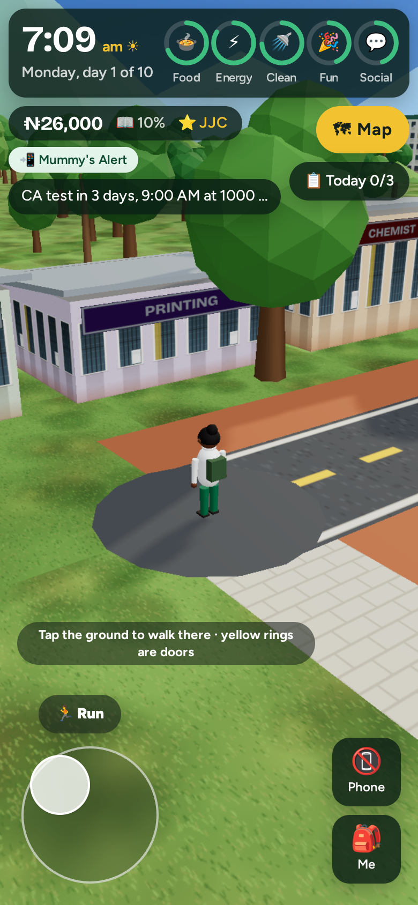 | 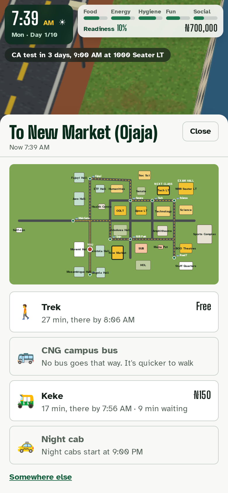 | 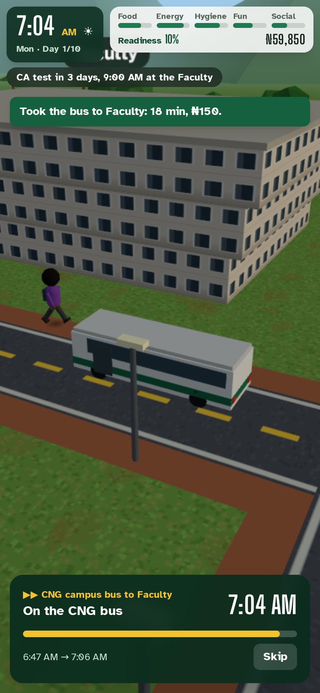 |

| Your hall room, with real roommates | Hall or off campus | After calling home |
|---|---|---|
| 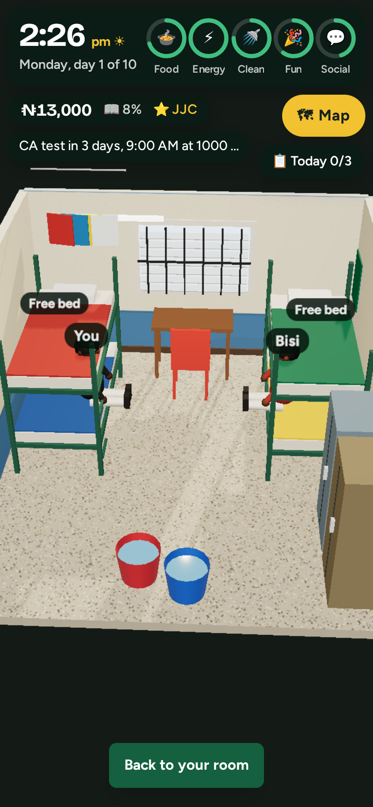 | 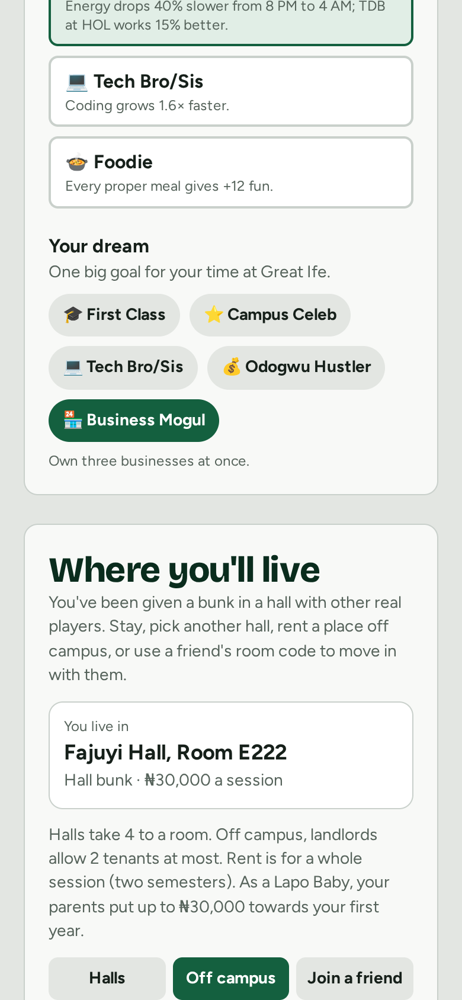 | 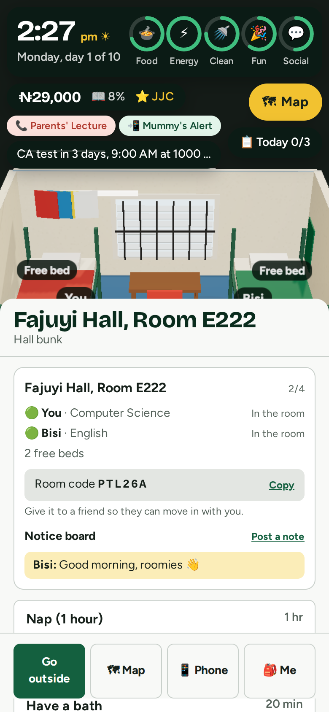 |

| Inside a lecture theatre | Mama Put | A bank hall | Send money |
|---|---|---|---|
| 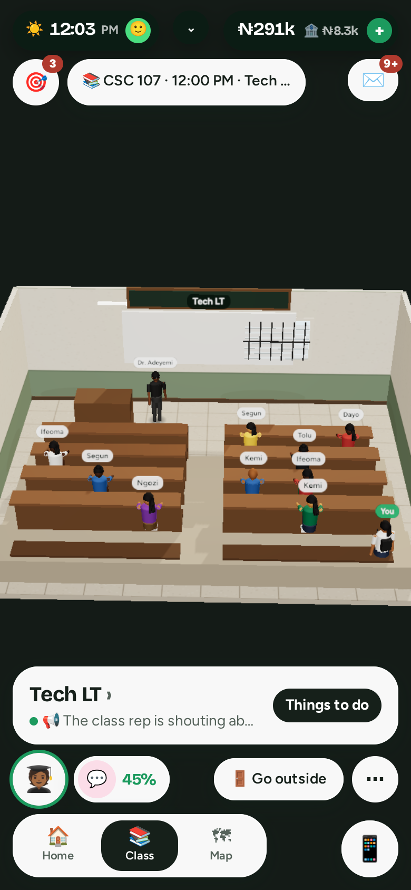 | 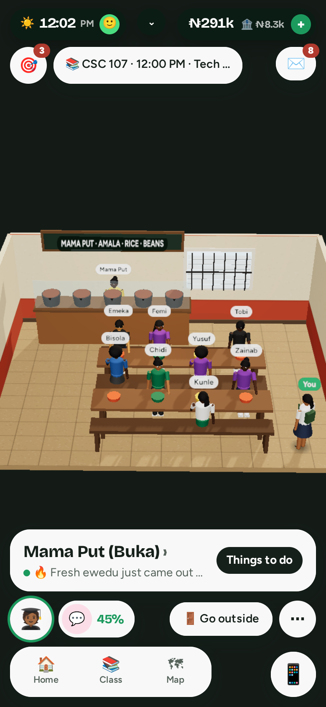 | 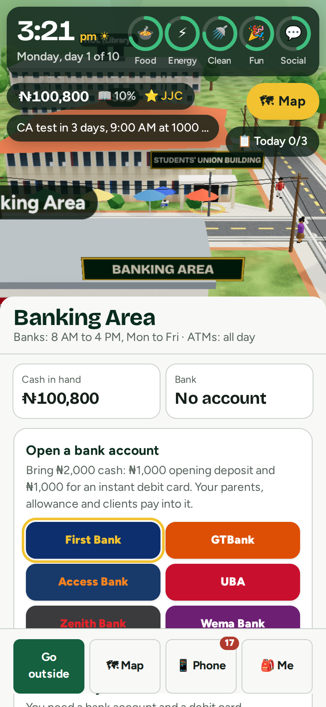 | 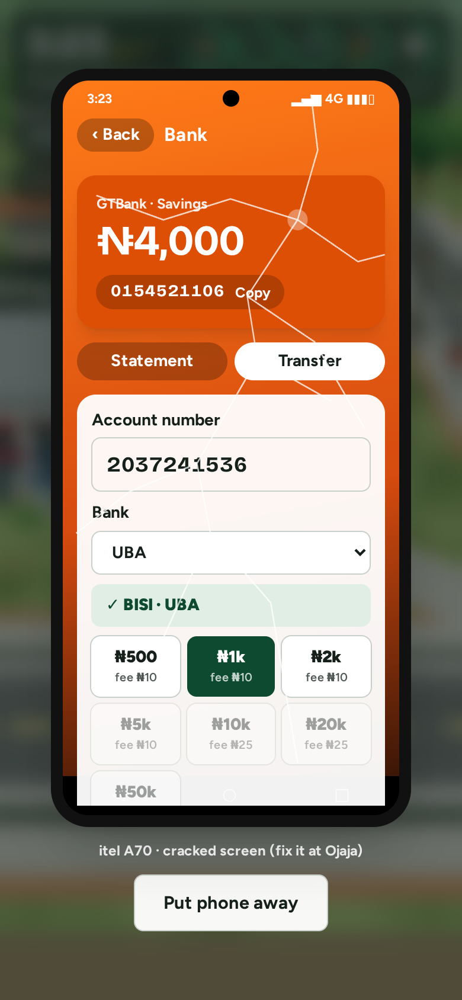 |

| The Banking Area | Open an account | Send money | Gist with coursemates |
|---|---|---|---|
| 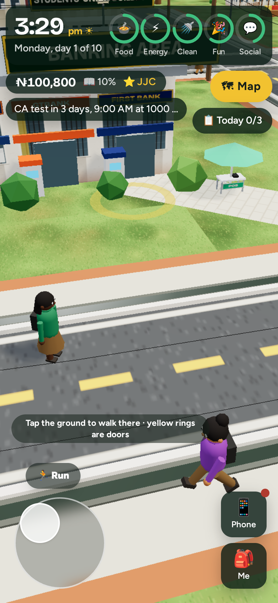 |  |  | 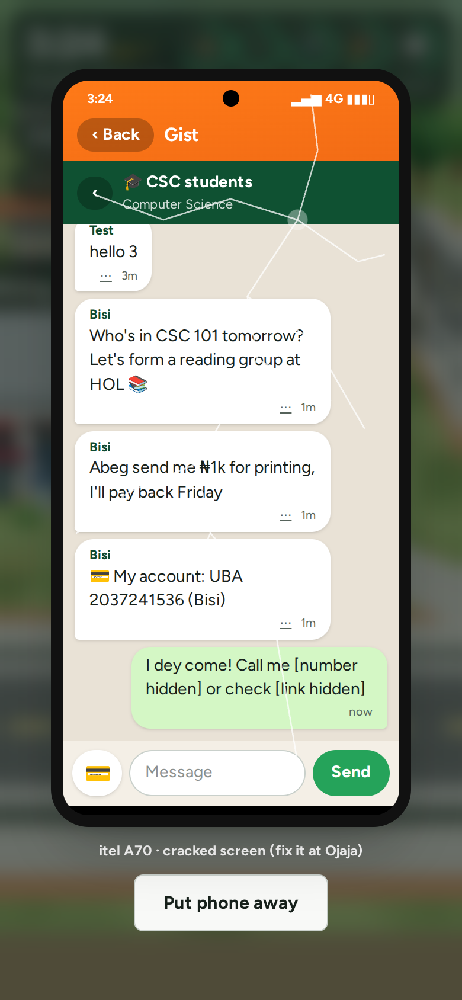 |

| Make your student | Ojaja market | Waiting for a keke | Graduation |
|---|---|---|---|
| 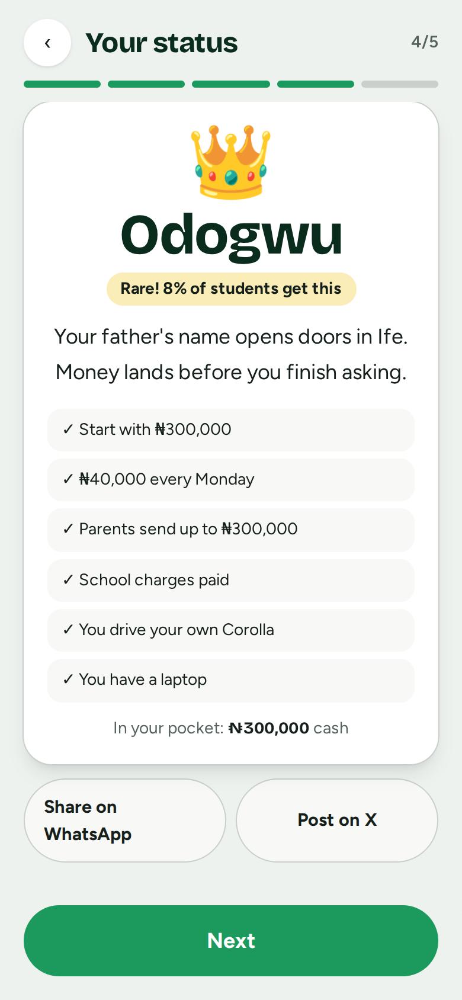 | 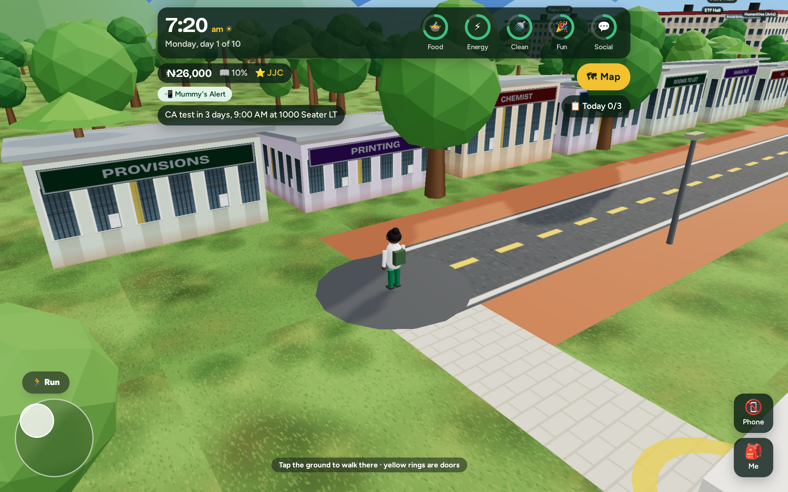 | 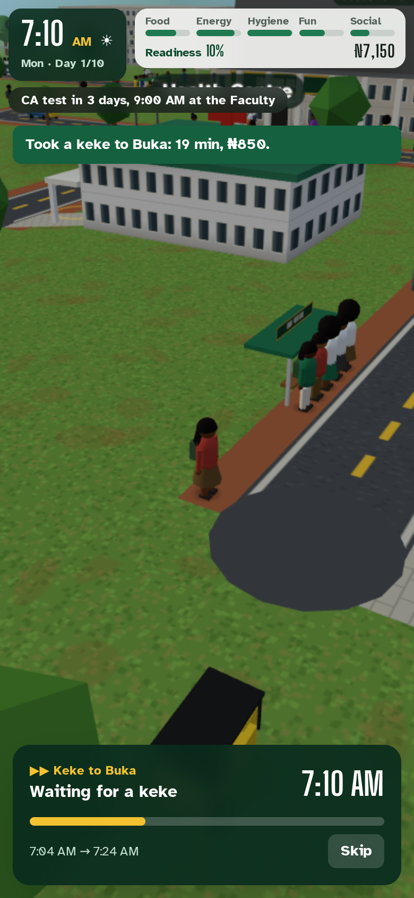 | 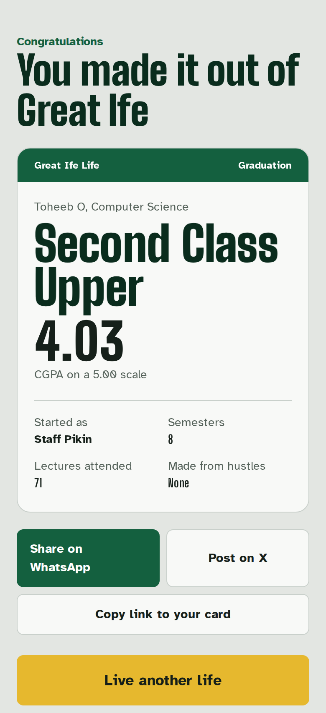 |

**Your phone looks like your phone:** an iPhone, a Tecno, a Samsung, a cracked screen, a torchlight Nokia, or none at all.

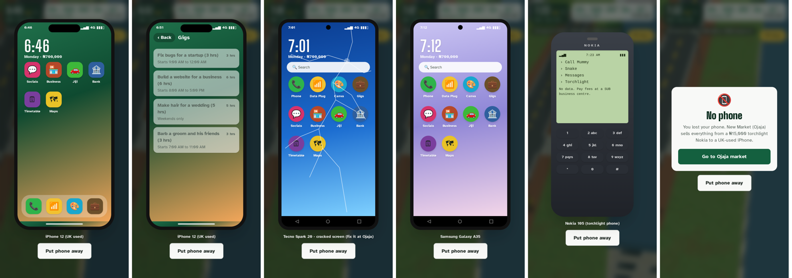

## How it plays

- **Laid out like a phone life game.** The 3D campus fills the whole screen and every control floats over it as a small pill:
  - **Top (things you read):** a clock pill with your mood face, a chevron that drops down a status drawer (date, semester day, cash and bank, readiness, students online, sound), the wallet pill, an inbox with a badge, today's missions and your next class.
  - **Bottom (things you press):** your avatar, one pill showing your *lowest* need, a single context button ("Go inside Awo Hall", "Go outside", "📍 Where to?"), a floating Home · Class · Map bar, a ⋯ menu, and a round Phone button with a chat badge. On campus, the joystick takes the nav bar's place.
  - **Places, then stations, then action cards.** Each building has a place card ("Moremi Hall · 2 here"). Tap it for station chips (👥 Roommates, 🏦 Money, 📚 Study, 🍲 Food, 💼 Hustle…) and cards showing an icon, real seconds, the price or "Free", and +Food / +Readiness tags. There's also a chat line for everyone in that place.
  - Running actions shrink to a ring chip at the top-left. One toast shows at a time. Events arrive as cards at the bottom, and every menu is the same slide-up sheet with pill tabs.
  - **Travel:** tap a pin on the map, see the place, pick a transport tile (🚶 Trek Free, 🛺 Keke ₦200…), then press "Go · ₦200".
  - Sounds are made in the browser (no audio downloads), phones give a short vibration, and desktop has shortcuts (M map, P phone, S you, I inbox, H home, C class).
- **Every building has an inside.** Lecture theatres with raked benches and a whiteboard, HOL with shelves and reading lamps, Mama Put with black pots and benches, Ojaja's stalls, the SUB business centre, the Health Centre, the bank halls, Oduduwa Hall's stage, and hall common rooms.
  - Inside, you see who's there: staff (Mama Put, Dr. Adeyemi, the tellers), campus students with white name tags, real players with blue @name tags, and you in green.
  - **Tap things to use them:** in your hall room, the bucket for a bath, the gas cooker to cook, the bunk to sleep, the reading table to study, the door to go out. Tap yourself for things you can do alone. It's the same in every building: tap the buka counter, the library shelves, the ATM. While an action plays, you walk over to it.
- **The Banking Area is a real place.** Walk into any bank's hall (First Bank, GTBank, Access, UBA, Zenith, Wema) to open an account or use the counter, and use any bank's ATM with your card. **Type any amount** (with quick chips), and the button repeats it: "Withdraw ₦7,500 · fee ₦35". Your bank card also works at every POS agent.
- **Admission is a 5-step wizard:** your look, two traits, your dream, a slot-machine **status lottery**, then where you'll live.

- **A 3D campus you walk around.** Low-poly Great Ife, with real names:
  - **Lecture theatres:** ODLT, the 1000 Seater LT, Ajose LT, the BOO theatres and Tech LT, plus faculty buildings with classrooms (Technology, Science, Social Sciences & Admin, Humanities). Each course has its own venues: CSC lectures are at the Faculty of Technology, Tech LT and the 1000 Seater.
  - **Halls:** Awo, Fajuyi, ETF, Moremi, Akintola, Mozambique and Angola, with male and female halls.
  - **Around campus:** SUB, Oduduwa Hall, the Senate building, HOL, the Health Centre, Mama Put, the Amphitheatre, the Sports Complex, Road 7 staff quarters, **New Market (Ojaja)**, the GREAT IFE gate, and Asherifa's shops outside it.

  Walk with the joystick (or W A S D), tap the ground to walk there along the roads, and hold Run to go faster. Step into a yellow ring to go into a building. You get real-time shadows on most phones and computers; very old phones skip them. Other students trek to class, CNG buses run their loop and stop at the bus stops, and kekes and cabs drive past.
- **The real Nigerian clock.** Like Lagos Life, game time is real Lagos time (WAT): if it's 2:30 PM in Ife, it's 2:30 PM on campus. An 8 AM lecture happens at 8 AM, night falls when it's night, and a 10-day semester takes two real weeks.
  - Actions play out in seconds and don't move the clock: a plate of amala or two hours of reading at HOL finishes while you watch a short progress bar.
  - So nobody reads 20 hours straight, there's a daily limit on studying and paid work. Sleep is real: you go to bed, and your needs keep changing while you're away.
- **Lectures at fixed times.** Each semester has a timetable: two lectures every weekday, at 8, 10, 12 or 2, at your lecture theatres.
  - Doors open an hour before, and students come early to keep seats.
  - Come 20 minutes early and you keep a seat in front, which helps your readiness. Come on time and you sit at the back.
  - Come more than 15 minutes late and you stand by the window. After 40 minutes, the doors are shut.
  - The **CA test** and **exams** start at **9:00 AM sharp**. Miss them and you score 0.
- **Who you are.** At admission you pick two of ten traits and one dream:
  - **Traits:** Hustler, Bookworm, Owambe Spirit, Gym Rat, Smooth Talker, Lazy Bone, Clean Pikin, Night Crawler, Tech Bro/Sis and Foodie. Each changes how fast needs drop or skills grow.
  - **Dreams:** First Class, Campus Celeb, Tech Bro/Sis, Odogwu Hustler and Business Mogul.
- **Today on campus.** Three new missions every morning (easy, around campus, hustle), with a bonus for finishing all three. A daily streak rewards coming back each real day, and day 7 opens the Sunday chest.
- **Campus Rep.** Lectures, missions, hustles, events and A grades build your name: JJC → Fresher → Stalite → Aluta Soldier → Big Shot → Campus Celeb → Great Ife Legend.
- **Moodlets.** Short feelings that change your mood and how well you read: Belle Full, Mummy's Alert, Front Seat, Slept Like an Oba, Hall Pride, Straight A's, Carry-Over, Embarrassed, and "Sapa Don Hold Me" when you're broke.
- **Lectures with moments.** Sometimes the lecturer points at you, roll call tempts you to answer for a friend, your phone rings in class, or there's group work. There are also real pop quizzes for your course (Computer Science, Economics, Accounting, Microbiology, Political Science, English) and general studies about OAU.
- **A Map button that's always on screen.** It shows the whole campus, your next class and your exam hall, and the bus stops. Tap any place to see how to get there.
- **Getting around at student prices.** Every trip gives you a choice, each with the travel time, the fare and the arrival time:
  - **Trek:** free, but tiring.
  - **CNG campus bus:** ₦100. Like the real CNG buses, it links the Main Gate, the halls (Awo, Fajuyi, Moremi, AngloMoz), New Market and SUB. It doesn't go round the faculties: it only drops you in front of one it passes, like ODLT. Queues are long at rush hour and on Sundays.
  - **Keke:** how most students get to their faculty. Door to door, ₦100 to ₦200 depending on distance, until 10 PM. The main keke park is at New Market, with smaller ones at the halls, SUB and the gate.
  - **Night cab:** only from 9 PM, only between the Main Gate and a bus stop, ₦250 to ₦300.
  - **Your own ride:** a bicycle (from Ojaja) or a car (the Staff Pikin drives Daddy's Corolla; anyone rich enough can buy one on Jiji). Door to door, any time, with petrol at ₦100 to ₦200 a trip.

  Off-campus students take the **town bus** (₦200) from Asherifa to the gate first. Your journey then plays out on the road: you walk to the stop, queue, watch the bus pull in, and ride.
- **Admission is a lottery.** You pick your course, and the game rolls your money status:
  - **Lapo Baby** (common): arrives with ₦100,000 cash, a cracked itel, and hustles pay 30% more. Parents send ₦20,000 at most.
  - **Nepo Baby:** ₦200,000 cash, an Infinix, a laptop, ₦10,000 every Monday, school charges paid. Parents send up to ₦100,000.
  - **Odogwu** (rare): ₦300,000 cash, an iPhone, a laptop, your own Corolla and ₦40,000 a week. Even Odogwu's parents send ₦300,000 at most, however much you ask.
- **Where you live.** Not everyone lives on campus:
  - **Hall bunk** (₦30,000 a session): four to a room, and your roommates are **other real players**. Share a room code to make sure a friend lands in your room.
  - **Off campus** in Asherifa, Damico, Mayfair, Parakin and more: a **single room** (₦120k–₦150k), a **self-contain** (₦250k–₦600k) or a **2-bedroom flat** (₦800k–₦1.5M), the highest a student can live. Landlords allow two tenants at most, and a flatmate pays half.
  - What you can afford depends on your status: your parents put money towards your first year's rent. Rent falls due again each session.
  - **Your room in 3D:** bunk beds, buckets, lockers and a clothes line in a hall room; a bed and a fan in a single room; a kitchenette or a parlour off campus. Your roommates sit on their beds with their names above them, or show as "out" or asleep. A notice board lets roommates leave each other short messages.
- **Cash and the bank.** You arrive with cash. Open an account at any bank in the **Banking Area** (First Bank, GTBank, Access, UBA, Zenith, Wema: 8 AM to 4 PM on weekdays, ₦1,000 opening deposit and ₦1,000 for an instant debit card), or a fintech account (OPay, Moniepoint) on your smartphone.
  - Parents, your weekly allowance and freelance clients pay **into your account number**, so until you open one, your parents hold your allowance.
  - Get cash at the **ATM** (free at your own bank's ATM, ₦35 at another bank's, ₦100,000 a day, and sometimes "Unable to dispense cash") or from a **POS agent** in every hall, faculty, lecture theatre, the market and SUB: swipe your card or transfer to the agent, ₦100 for every ₦5,000, a little more at night in the hostel.
  - Kekes, buses and cabs take cash only. Shops and Mama Put take cash or a transfer. The portal, Jiji and betting are paid from the bank.
  - **Send money to other students** by account number from your bank app. It checks the name first, charges ₦10 to ₦50 like a real transfer, and they get a credit alert.
  - Carrying lots of cash is risky: hostel rooms get broken into.
- **Gist with other students.** A chat app with your roommates, your department, and one-to-one chats started from a student's matric number. You can share your account number in one tap.
- **Ways to make money:** hustles (chin-chin, barbing, shoemaking), freelancing (flyers, articles, transcription, websites, bug fixing on your laptop), **calling home** once a week (parents often send less than you ask, sometimes after a lecture), and a **betting app** with virtual matches. The odds are honest, so the bookie keeps about 12% and you lose more than you win.

  Then you choose how your student looks: skin, hair (low cut, afro, braids, bun, dreads), clothes, and trousers or a skirt.
- **Keep five needs up:** food, energy, hygiene, fun and social. They fall little by little (a good meal lasts most of the day), faster if you're awake past 1 AM. Let food or energy hit zero and you collapse and wake up at the Health Centre.
- **Readiness** goes up as you study. The CA test (30%) and exams (70%) turn it into grades on the 5-point scale, A to F. Failed courses become **carryovers**.
- **Pay your school charges** on your phone, or you can't write exams. Short on money? A loan app will lend it to you, and take back 30% more.
- **Random campus events:**
  - NEPA takes light, and the taps run dry.
  - Your roommate borrows money.
  - The lecturer doesn't show up.
  - Free jollof at a departmental seminar.
  - SU elections.
  - The rare ASUU strike that pauses everything.
- **Your phone matters.** The phone screen looks like the phone you have:
  - The Staff Pikin has an iPhone 12, the Hustler a cracked itel, and others a Tecno or an Infinix.
  - A **torchlight Nokia** can only call home and play Snake. You pay school charges at a SUB business centre instead.
  - Brands only want skits shot on a good camera.
  - Phones get **cracked, stolen or drowned in a bucket**. Buy a new one at Ojaja.
- **New Market (Ojaja):** buy phones (₦15,000 Nokia to ₦520,000 UK-used iPhone), fix cracked screens, buy foodstuff (cooking becomes free, and you can soak garri), get a bicycle, buy barbing clippers or a shoemaker's kit, learn barbing or shoemaking from the people there, eat puff-puff, or work at a phone accessories shop.
- **Campus hustles:**
  - Fry and sell chin-chin.
  - Barb your hall-mates.
  - Braid hair.
  - Mend shoes and make palm slippers.
  - Sell data, design flyers, run tutorials, fix bugs for startups.
  - Build websites and do brand deals.
- **Skills with ten levels, shown as ten bars.** Fill a bar to reach the next level.
  - **Trade skills:** coding, graphic design, hairdressing, barbing, shoemaking, content creation and teaching.
  - **Hustling** grows with every hustle and makes all hustles and businesses pay more.
  - **Charisma** grows when you're social: gisting, hanging out at SUB, shows, football, study groups.
  - Higher levels pay more and unlock big jobs: a website for ₦22,000, wedding hair, a groom's squad's haircuts, brand deals.
- **A laptop for tech students.** Buy one at New Market (₦280,000). The Staff Pikin and the Scholarship Kid start with one. Practise coding from your room or HOL, then take bug-fixing, logo and website gigs.
- **Businesses that pay out every night:**
  - A data kiosk.
  - A printing stand.
  - A food stall.
  - Chin-chin supply to hall shops.
  - A shoe repair stand at Ojaja.
  - A barbing salon at Ojaja.

  Selling one gets you 60% back.
- **21 badges** to chase, including Legs of steel (trek 20 km), Early bird, Own your ride, New phone, who dis?, Living the dream and Great Ife Legend.
- **Graduate after 8 semesters** (plus an extra year if you have carryovers) with a degree class, a shareable graduation card, and a place on the leaderboard.

A semester is ten game days. Everything is saved on the server. **Create a free account** (username and password, no email) to continue on any phone, and see all your past lives, like signing in to Lagos Life. Without an account, a save code works too.

## Engineering highlights

- **The server owns the clock.** Game time is real Lagos time, worked out on the server. Days, missed lectures, exams and needs while you were away are all worked out from real time when you come back, and the browser can't speed anything up.
- **A real banking system, server-side.** Every account number is unique in the database. A transfer debits the sender inside their locked game row and queues a credit that lands the next time the receiver's game talks to the server, so it can't be applied twice or replayed.
- **Real roommates.** Rooms are database rows shared between players. Moving in locks the room row, so two players can't take the last bed at once, and halls fill existing rooms before opening new ones so freshers get roommates.
- **No teleporting.** When you walk into a building, the server checks you could have walked there from where it last saw you in the time that passed. Heartbeats with impossible positions are ignored.
- **Honest travel quotes.** Bus queue lengths are seeded by the half hour, so the time you're quoted is the trip you get. The CNG bus planner tries every stop pair on the one-way loop, and Dijkstra's algorithm finds the roads.
- **One map, two uses.** `game/world.py` defines the campus once. The server uses it for distances, fares and opening hours, and the three.js client draws it from `GET /api/world/`.
- **The server decides everything.** The browser only says "I want to do X". The server checks it's allowed, applies the rules inside a database transaction, and sends back the new state. Players can't edit their money or grades in the browser, which is how Lagos Life's economy was broken by hacked billions.
- **No double moves.** Every move carries the turn number it was made on. A double tap or a replayed request gets `409 Conflict` instead of acting twice, and rows are locked with `select_for_update`.
- **Luck can't be rerolled.** Randomness is seeded from the game's seed plus the turn number, so retrying a request gives the same outcome.
- **A pure rules engine.** `game/engine.py` has no Django or database code. It takes a state and returns a new one, which makes it easy to test, and easy to simulate thousands of games to balance.
- **Balanced by simulation.** Bots that keep the timetable, choose transport and look after their needs played full degrees from every starting life, and the results shaped the rules:
  - Hard workers earn a First or a 2:1, and business builders a 2:2 with lots of money.
  - Lazy students get a Third or a 2:2, and neglect fails.

  The same bot plays whole degrees in the test suite.
- **Built for Nigerian networks.**
  - Rate limits apply per game, not per IP, because campus Wi-Fi and mobile carriers put thousands of students behind one IP.
  - Fonts are self-hosted.
  - The title page loads about 64 kB of JavaScript (gzipped). The 3D campus (three.js, about 130 kB) downloads only when you start playing.
  - Every texture (signs, windows, grass, roads) is drawn in code: there are no image downloads.
  - Shadows are cheap blob shadows, trees are instanced, and resolution is capped on low-end phones.
- **Shareable by design.** The admission letter and graduation card are made to be shared on WhatsApp and X. Shared card links get personalised preview text ("Tunde graduated with First Class (4.62)") generated by the server.
- **Accounts that work for students.** Username and password only, with no email or phone number collected. Each device gets its own token (stored hashed), so signing in on a laptop doesn't log your phone out. Password guessing is rate-limited per username.
- **An installable app (PWA).** It has a web app manifest, maskable icons and a service worker, so it installs to the home screen, opens full screen, and loads even offline. Game moves are never cached, so progress can't fork or be faked offline.
- **Old saves keep working.** `engine.upgrade()` brings saved games up to the newest version when you open them, so updates never wipe anyone's progress.
- **Safe for a student audience.** Many players are teenagers, so chat is built carefully:
  - The server hides phone numbers, links, emails and social handles, so conversations stay in the game, and stars out rude words.
  - Anyone can be blocked (neither of you sees the other) or reported. Three reports hide a message until a moderator looks, and moderators can hide messages or pause a player's chat in Django admin.
  - Sending is rate-limited per player.
  - Money transfers are game money only, with daily limits. Betting asks you to confirm you're 18 or over, and locks you out after 10 bets a day. Leaderboard names are filtered, and admins can hide a game in Django admin.

- **Looks like Ife, not a toy town.** Walls are drawn at runtime with damp plaster, rain streaks under louvre windows, burglar-proof bars, the odd AC unit and red-earth splash at the base.
  - Roofs carry water tanks, roads have open gutters, and NEPA poles string sagging wires across campus.
  - On capable devices, materials are physically based and lit by the sky as well as the sun; the sun glows in the sky and clouds drift past. Low-end phones get a lighter path automatically.
  - Nothing is downloaded for this: every texture is painted on a canvas, which matters on Nigerian data plans.

## Tech

| | |
|---|---|
| Backend | Django 5.2, Django REST Framework |
| Frontend | React 18, React Router, Vite, Tailwind CSS v4, three.js (3D campus) |
| Fonts | Bricolage Grotesque (headings, clock, signs), Figtree (everything else), both self-hosted variable fonts |
| Database | PostgreSQL (Neon) in production, SQLite locally |
| Hosting | One free Render web service; Django serves the built React app with WhiteNoise |
| Tests | 99 backend tests (pytest, including whole degrees played by bots), frontend unit tests (Vitest), browser walkthroughs incl. the 3D campus, journeys, two-device sign-in and offline (Playwright) |

```
backend/
  game/world.py     the campus map: halls, lecture theatres, market, roads, bus stops, fares
  game/content.py   activities (where, how long, what hours), profiles, events: edit this to add jokes
  game/engine.py    the rules: the clock, needs, travel, lectures, tests, exams, grades, events
  game/views.py     API: new game, sync, plan, travel, enter/exit, act, choose, leaderboard, cards
  config/views.py   serves the React app, with share previews for /c/<code>
  tests/            incl. bot.py, a bot that plays like a person
frontend/src/
  game3d/           three.js campus: world (buildings, roads), characters, vehicles, traffic, Engine
  pages/            Title, NewGame, Admission (avatar creator), Play (3D + HUD), Graduation
  components/       Hud (clock, needs, joystick, map, journey bar), Phone (iOS, Android, Nokia), Dialogs
```

### Adding content

Most of the fun lives in [`backend/game/content.py`](backend/game/content.py). To add an activity or an event, add a dictionary there. `at` is a building from [`world.py`](backend/game/world.py), `"home"` or `"phone"`. For example:

```python
{"id": "fried_rice", "at": "buka", "label": "Fried rice and plantain", "hours": [(H(11), H(20))],
 "minutes": 30, "cost": 1200, "effects": {"hunger": 50, "fun": 5},
 "blurb": "Extra plantain if you know the seller."},
```

To add a building, add it to `BUILDINGS` in `world.py` with a road node, size, style and opening hours. The 3D campus picks it up automatically.

After a change, run `pytest`: bots play full degrees and check that nothing breaks.

## Run it locally

You need Python 3.11+ and Node 20+.

```bash
# Backend
cd backend
python -m venv .venv
source .venv/bin/activate          # Windows (Git Bash): source .venv/Scripts/activate
pip install -r requirements.txt
python manage.py migrate
python manage.py runserver

# Frontend (second terminal)
cd frontend
npm install
npm run dev                        # http://localhost:5173
```

```bash
cd backend && pytest               # 99 tests, including whole degrees played by bots
cd frontend && npm test
```

## Deploy on Render (free)

1. Create a free Postgres database on [Neon](https://neon.tech) and copy its connection string (click *Show password* first).
2. On Render, go to **New → Blueprint** and pick this repository. Render reads `render.yaml`. Paste the Neon string into `DATABASE_URL`.
3. Wait for the first deploy (about 5 minutes), then open the URL and get admitted.

Optional environment variables: `THROTTLE_ACT` (default `240/min` per game), `THROTTLE_SYNC` (default `120/min` per game, for clock heartbeats), `THROTTLE_NEW_GAME` (default `300/hour` per IP), `THROTTLE_LOGIN` (default `10/min` per username).

## Get it on phones

### 1. Install from the website (works today, free)

Once deployed, the game is an installable app:
- **Android:** open the site in Chrome, tap **Install the app on your phone** on the title screen (or Chrome's menu, then **Install app**).
- **iPhone:** open the site in Safari, tap **Share**, then **Add to Home Screen**.

It gets its own icon and opens full screen. This is how most players should install it at first: it's free, and updates reach everyone instantly.

### 2. Publish on Google Play

Because the game is a proper PWA, it can be wrapped as a **Trusted Web Activity**: a real Android app that shows your site full screen. You don't need to rewrite anything.

1. **Create a Google Play developer account** at [play.google.com/console](https://play.google.com/console). There's a one-time fee (about $25), and Google verifies your identity.
2. **Package the app with PWABuilder.** Go to [pwabuilder.com](https://www.pwabuilder.com), enter your Render URL, and choose **Package for stores → Android**. Use a package ID like `com.horrly.greatifelife`. You get:
   - an `.aab` file (the app),
   - a signing key, which you must **back it up and never lose**,
   - an `assetlinks.json` with your certificate's SHA-256 fingerprint.
3. **Prove you own the site.** In Render's Environment tab, set:
   - `ANDROID_PACKAGE_NAME`: your package ID.
   - `ANDROID_CERT_SHA256`: the fingerprint. After the first upload, also add the **App signing key certificate** fingerprint from Play Console → *Test and release → App integrity*, comma-separated.

   Then check `https://<your-app>/.well-known/assetlinks.json` shows them. Without this, the app shows a browser address bar.
4. **Closed testing first.** New personal developer accounts must run a closed test with **at least 12 testers for 14 days in a row** before they can publish to everyone. OAU friends and coursemates are perfect testers.
5. **Store listing:** screenshots (in `docs/screenshots/`), the 512px icon (`frontend/public/icons/icon-512.png`), a short description, the content rating questionnaire, and a privacy policy link: use `https://<your-app>/privacy` (already built into the game).
6. **Apply for production access** in Play Console, then publish.

Updates to the website reach the Android app automatically. You only re-upload to Play to change the icon, name or package.

### 3. The App Store (later)

The iPhone App Store is harder for a web game:
- The Apple Developer Program costs **$99 a year**.
- You need a **Mac with Xcode**, or a cloud build service.
- Apple's guideline **4.2 (Minimum Functionality)** rejects apps that are "just a website in a shell".

The realistic route is to wrap the same React app with **Capacitor** and add native features Apple values, like push notifications ("Exams start tomorrow!") and the native share sheet. Until then, iPhone players can install it from Safari (step 1), which works well.

## Inspired by Lagos Life, made safe for students

Great Ife Life borrows what makes Lagos Life fun: fast actions on a real clock, small choices inside lectures, daily missions and streaks, Rep titles, traits and moodlets. It deliberately leaves out Lagos Life's open job boards, open election promises, crime and real-money trading. Betting is in, but it's 18+, capped per day, and shows honestly that the bookie wins in the long run.

## Ideas for what's next

- Hall-mates: see other real players walking on campus and at HOL (Django Channels, already used in my Relay project)
- Interiors you can walk into: the lecture theatre and the HOL reading room
- An SU election that players actually vote in, once a week
- More departments, including 5- and 6-year courses
- Cosmetic extras through Paystack, using my [django-paystack-kit](https://github.com/Horrly/django-paystack-kit)

## License

MIT © Toheeb Olatunde


## Real people (October 2026)

Every student and campus person is a rigged human body with real animation: idle breathing, walking,
jogging, sitting, eating, talking on the phone, lying down to sleep. The models are CC0 packs by
Quaternius (see `frontend/public/models/CREDITS.txt`), packed into three GLB files (about 4.5 MB in
total, cached by the browser). Skin tone, hair style and colour, beard, top colour, fabric print
(Ankara, Adire, Aso-oke), trousers or skirt, and shoes are all chosen in the look editor.

Only the people nearest the camera get the full body; the rest of the campus crowd uses a light
stand-in, so the game stays smooth on cheaper phones.

## Added from the Lagos Life review

- Tap anyone in a place: say hello, gist, crack a joke (with a success chance) or throw shade.
  Real students can also be messaged, sent money straight into their account, invited to your room,
  or blocked.
- The place sheet shows a blurb, what you can do there, and who is there now.
- The map fits the campus, has category filters and search, and shows closed places.
- A bubble floats over your head while you're doing something; needs under 20% warn you once.
- SUG election in the OAU Portal (one vote per student per week).
- A daily campus riddle: go to the right place and search; the first finders win naira.
- Big-spender moments: buy food for the whole buka and everyone there sees a gold banner.
- A till slip of what you've spent at a place.
- Works on small phones, phones on their side, tablets and desktops.

## Added from the Lagos Life design guide

- **Friendships.** Everyone you talk to moves from Stranger → Acquaintance → Friend → Close friend → Bestie. Tapping a person shows how close you are and a progress bar. *Hype them up* opens at Acquaintance, *Talk about life* and *Hang out* at Friend, and *Ask for small money* at Close friend (campus people only, once a day). Shade costs friendship. You → 👥 People lists everyone you know.
- **Safer money and chat.** Chat messages and transfer notes that offer to trade game money for real money ("OPay", "fake alert", "cash out"…) are refused with a plain explanation. This closes the scam hole the guide ranked worst.
- **Chat.** DMs show a 🔒 private line, a "Say hi" empty state and one-tap Pidgin quick replies.
- **Send money.** The button echoes the amount and fee ("Send ₦5,000 · fee ₦10"), and there's a Max chip.
- **Closed places say when they open** ("🔒 Closed now · opens 7:00 AM").
- **Keyboard:** `?` shows every shortcut and `F` opens People. *You* moved from `S` to `Y`, because `S` also walks backwards.

### Round two from the guide

- **Faster first load on slow data.** `npm run build` now also writes `.br` and `.gz` copies of the game code and 3D people (`frontend/scripts/compress.mjs`), and WhiteNoise sends the smallest copy the phone accepts. The female model drops from 2.0 MB to 0.8 MB, and everything together from 5.6 MB to about 2 MB.
- **Flat map option.** On data-saver or 2G connections the map opens flat; a **2D** button on the 3D map and **Show the 3D map** on the flat one switch views, and the choice is remembered.
- **Apps open over the first days.** Day 1 has the essentials (Portal, Gist, Bank, Call Mummy, Houses, Timetable, Maps). Data Plug, Socials and Freelance arrive on day 2; Gigs, Canva and OgaBet on day 3; Business on day 4; Jiji on day 5. New apps wear a red NEW tag until opened.
- **Student hustles.** A puff-puff and buns stand joins the businesses, and the Business app can promote them: WhatsApp status (+10% tonight), flyers (+20% tonight) or a campus influencer (+50% for two nights).
- **More shared moments.** Lead an SUG rally at the SUB (weekdays 3–7 PM), lead your hall's war cry at the Sports Complex (4–8 PM), and walk the red carpet at the departmental dinner in Oduduwa Hall (Fri/Sat nights). Everyone there sees the gold banner.

## Real-life pace (October 2026)

- **People walk like people.** Bodies are drawn at 1.88 world units to the metre, so walking is now ~3 units/s (a brisk 1.5 m/s) and the Run button is a steady jog (~3 m/s). Before, everyone moved at a hurried 4 m/s with their legs racing. Campus walkers stroll, indoor walking is unhurried, and buses, kekes and cabs drive at believable speeds.
- **Work and gestures look steady.** A one-off gesture (eating, reaching, picking up, nodding) plays once, a little slower, then the person rests for a few seconds before the next. Kneeling repairs, pushing, watering and dancing loop a touch slower.
- **Actions take longer to watch:** an hour's work plays over about 15 seconds and a long shift over 30. Journeys are slower too. Tap the action chip ("× tap to skip") or **Skip ⏭** on a journey to move on; skipping never changes the result. Result messages now appear when the action finishes, not before.
- **Football you can watch.** The Sports Complex has a kickabout: the ball rolls along the grass and slows down, players jog to it and stroll into space, and **Play football** puts you in the game. **Jog round the track** runs real laps at jogging pace.
- **OgaBet matches play out** over 45 seconds, with a live minute counter, half-time and goals as they go in, instead of finishing in a blink.
- Door glows pulse slowly, and celebration emoji fall gently.

## Map fix: Akintola beside Fajuyi

Akintola Hall now stands right beside Fajuyi Hall. Coming along the hall road from ETF you reach Akintola first, and a paved footpath runs between the two halls down to Ojaja market (`FOOTPATHS` in `world.py`). Saved games move players standing at Akintola to its new door.

## A living campus day

- **Tap anyone walking about campus.** They stop, turn to face you, and their sheet opens: say hello, gist, joke or build a friendship, the same as with people inside places. They walk on once you're done.
- **Names match the person** (men's and women's names), and everyone has a role: 100L student, final-year, course rep, corps member…
- **Crowds follow the timetable.** Paths fill up when classes change (ten to the hour till ten past, 8 AM–5 PM), thin out in the evening, and are nearly empty late at night. In the morning people head to faculties and lecture theatres, at lunch to the buka and market, and in the evening back to the halls, the library and the sports complex.
- **Friends stop to gist.** Two students who meet on the road sometimes stop and talk for a few seconds before carrying on.

## Weather, body language and road sense

- **Rainy season weather.** The sky is the same for every player and changes every three hours, decided by the real date: about a 30% chance of rain from April to October, much less in the dry season. Rain falls at a real speed, the sky turns grey and the light dims, fewer people are out, and rain patters softly if sound is on. The clock shows 🌧️/⛈️/⛅. Kekes and night cabs charge a 25% "rain price", and trekking in the rain leaves you soaked (hygiene drops).
- **Gisting looks like gisting.** Outside, your student walks up to the person you stopped and you both talk with your hands. Inside, you walk over to the person you tapped, they turn to you and talk back (people sitting stay seated).
- **Idle like a real person.** Stand still for a few seconds and your student checks their phone, folds their arms or shifts their weight, changing every so often.
- **Vehicles stop for you.** Kekes, cabs and buses slow down and stop if you're standing in the road ahead of them.
